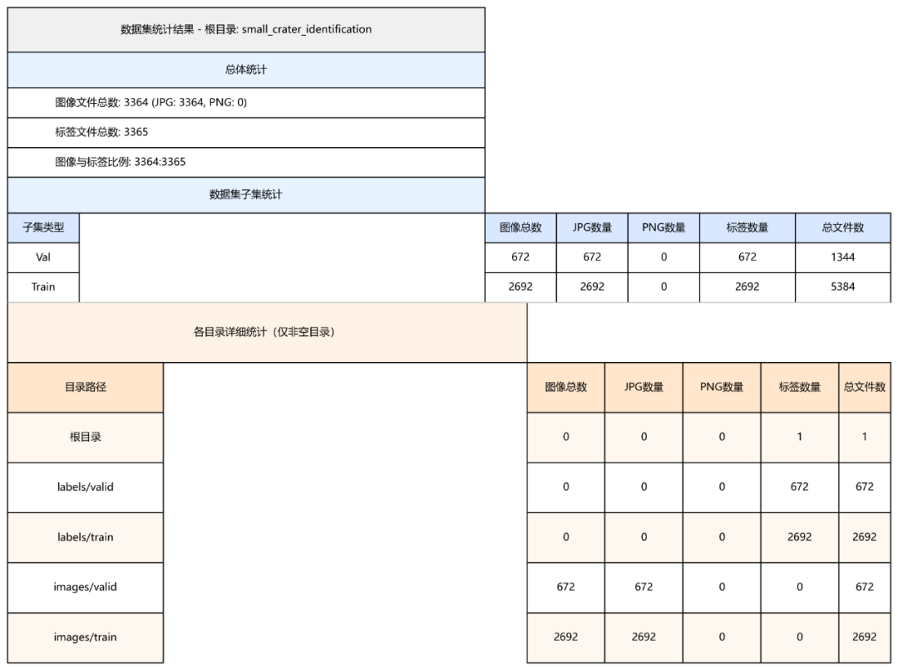
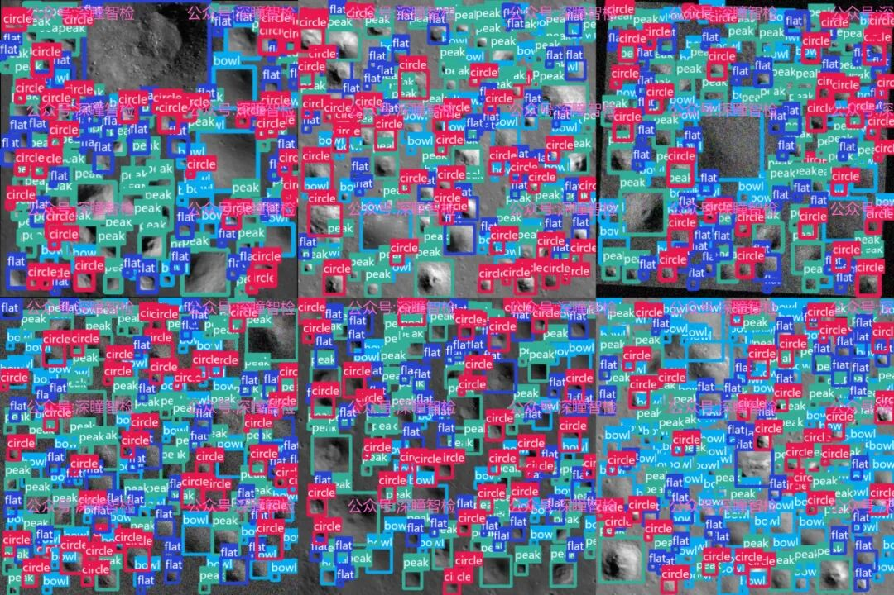
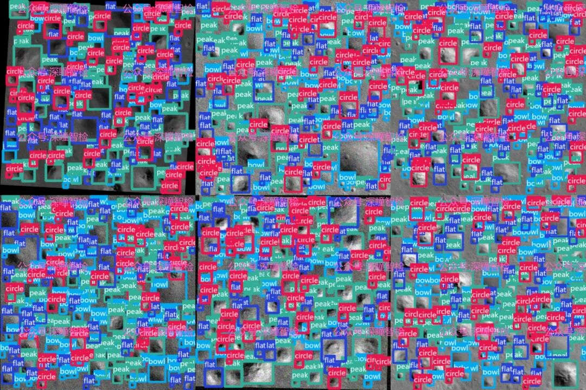

# Target Detection Dataset 084 - Small Impact Crater Recognition and Detection Dataset Based on YOLO Annotation Format

1. Background

The Moon, as Earth's only natural satellite, serves as a crucial stepping stone for human exploration of the universe. Its surface is dotted with impact craters, recording the history of meteor collisions in the solar system over billions of years, earning it the title "Geological Museum of the Solar System." By analyzing the morphology, size, and distribution patterns of lunar impact craters, scientists can infer the age of the Moon's surface and the intensity of geological activity, even revealing the early evolution of the solar system.

Firstly, the issue of **sample imbalance**: In natural conditions, the observational samples of ordinary circular craters far exceed those of special forms such as flat-bottomed craters, central hillocks, and concentric craters. This leads to the model training being biased towards the majority class, resulting in extremely low accuracy in recognizing rare shapes. Secondly, the image features of small craters are relatively blurred, with incomplete boundary information, making it difficult for traditional recognition methods to accurately extract effective features. Additionally, lunar images obtained from deep space exploration have resolution differences and complex lighting conditions, further increasing the difficulty of classifying small craters.

With the rapid development of artificial intelligence technology in remote sensing image recognition, deep learning models have provided a new solution for small impact crater classification. However, high-quality datasets are the foundation for the performance of deep learning models. Existing datasets either lack sufficient sample numbers or fail to effectively cover rare forms of impact craters, failing to meet the needs for precise classification. Therefore, constructing a specialized dataset that is enhanced through data augmentation, balanced across various sample distributions, and accurately labeled, has become key to breaking through the technical bottleneck of small impact crater classification, and also an important support for advancing lunar scientific research and deep space exploration technologies.

2. Data Details

**Core Dataset Positioning**

The core goal of the dataset is to address the sample imbalance issue in small impact crater classification, enhance the model's ability to recognize rare morphological impact craters, and provide reliable data support for the training and optimization of related deep learning models.

To effectively address the issue of class imbalance, the dataset employs advanced data augmentation techniques to emphasize the representation of rare morphological impact craters. Specifically, for three types of samples with limited quantities—flat pits, central crater pits, and concentric craters—the dataset expands the sample size through reasonable image transformation techniques such as rotation, scaling, and brightness adjustments. This approach ensures the authenticity and diversity of the samples while preventing model overfitting. For the numerous common morphological small impact craters, the dataset ensures efficiency by filtering high-quality samples and removing redundant data.

**Data Collection and Screening Criteria**

The dataset's annotation files are in txt format, conforming to the mainstream annotation standards in the field of deep learning. They can be seamlessly integrated into various models trained based on the YOLO framework, reducing the cost of data preprocessing for researchers. The annotation content precisely corresponds to the location, boundaries, and morphological categories of impact craters, ensuring that the model can learn effective recognition features.

The core strength of this dataset lies in two aspects: Firstly, **balanced sample distribution**. Through data augmentation techniques, the number of samples for various types of impact craters is reasonably balanced, effectively avoiding bias issues during model training; Secondly, **high-precision annotation**. Based on professional lunar remote sensing image analysis technology, each impact crater's boundaries and categories are precisely labeled, providing high-quality supervision information for model learning.

3. Application scenarios

3.1 Lunar Geological Scientific Research

This dataset can be directly applied to the classification study of lunar small crater morphology, aiding researchers in quickly and accurately identifying different crater shapes, thereby analyzing their spatial distribution patterns, formation mechanisms, and evolutionary processes. Through the classification and statistical analysis of a large number of small craters, this dataset can provide key data support for studies on lunar surface age determination and regional geological unit delineation, promoting the in-depth development of lunar geology. For example, models trained with this dataset can efficiently process massive remote sensing images returned by lunar probes, rapidly identifying specific areas with unique crater shapes such as flat-floor craters and central craters, providing an important basis for studying the geological activity history of these regions.

3.2 Deep Learning Model Training and Optimization

As a dataset specifically designed for classifying small craters, its core application scenarios are to support the training, validation, and optimization of deep learning models. Researchers can train various target detection and classification models based on this dataset, especially using the YOLO series of deep learning frameworks, to further improve the performance of models in scenarios such as small object recognition and rare category detection. Additionally, the data augmentation strategy and sample balance methods adopted by the dataset provide a reference example for other remote sensing image recognition tasks, promoting the widespread application of deep learning technology in the field of remote sensing.

3.3 Remote Sensing Image Recognition Technology Promotion

The construction philosophy and technical methods of this dataset can be extended to other remote sensing image recognition scenarios. For example, tasks such as the identification of asteroid impacts on Earth's surface and monitoring of geological disasters (such as collapse pits) also face issues like sample imbalance and difficulties in recognizing small targets. The enhancement strategies, annotation standards, and model adaptation experiences of this dataset can provide references for the construction and technological research of datasets in these fields, promoting the application and development of remote sensing image recognition technology in industries such as geological exploration and disaster monitoring.

## Payment

Here is a pay link on Stripe ( https://buy.stripe.com/3cs8yP7sY87d0vu9AB ). Please contact me lonlonago@foxmail.com after funding $89, and I will send you a complete data files , thank you!

